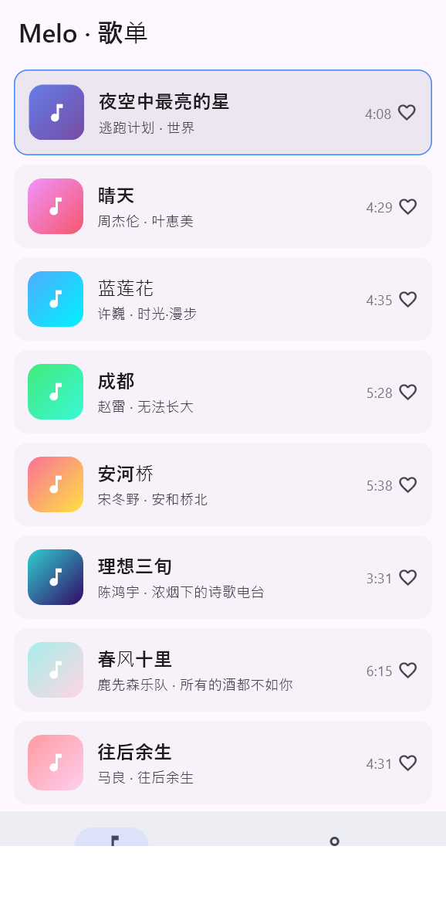
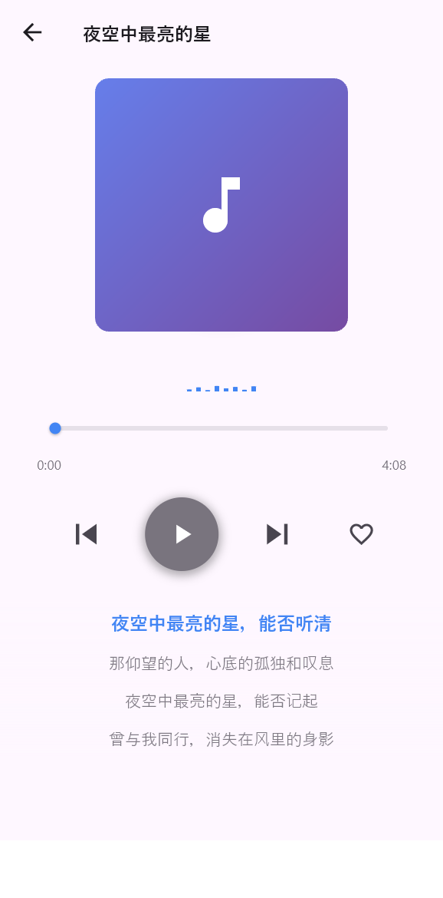
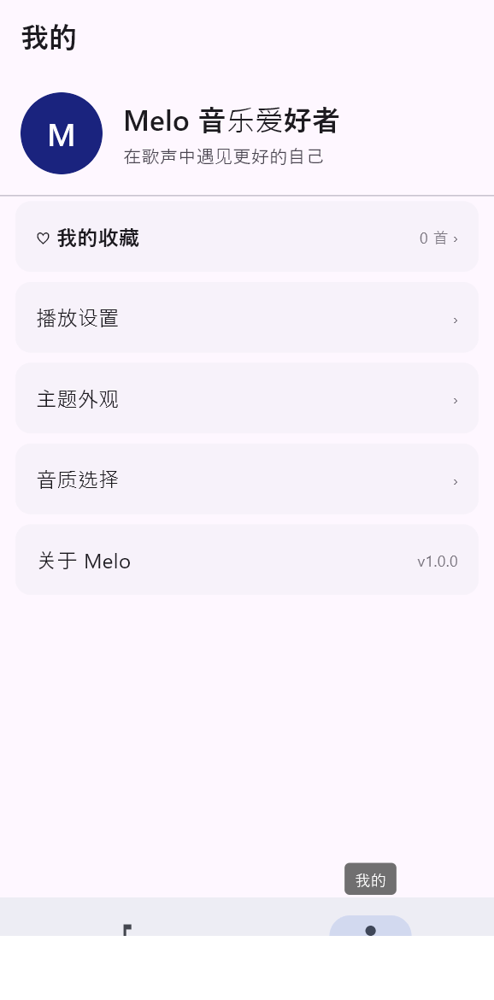

# Melo 音乐播放器（melo_player）

黑白胶质感的移动端音乐播放器练习项目，Flutter 单工程实现（Android / iOS / Windows 均可运行）。
库存 8 首歌曲为写死的 mock 数据，不联网、不接后端，重点演示 Flutter 第九章「动画」的六类核心 API。

## 界面预览

<p align="center">
  
  &nbsp;
  
  &nbsp;
  
</p>

<p align="center">
  <em>歌单列表 · 播放详情 · 个人中心</em>
</p>

## 功能

- **歌单列表**：8 首歌曲卡片，含封面、歌名、歌手、时长；点击任意卡片进入播放详情
- **播放详情**：大封面 + 黑胶唱片、频谱条、可拖动进度条、上一首 / 播放暂停 / 下一首、收藏爱心、歌词区
- **个人中心**：头像昵称、我的收藏（显示收藏数量）、播放设置 / 主题外观 / 音质选择 / 关于
- **页面跳转**：仅三个页面，通过点击卡片、返回按钮、底部导航互相跳转，不存在第四页

## 动画清单

| 序号 | 位置 | 动画描述 | Flutter API |
| --- | --- | --- | --- |
| 1 | 歌单列表页 | 8 张卡片自上而下逐个滑入并淡入 | `Interval` + `Tween<Offset>` + `FadeTransition` + `AnimatedBuilder` |
| 2 | 列表 → 详情 | 小封面连续放大移动到详情页大封面位置 | `Hero(tag: 'cover-N')` + `PageRouteBuilder`（300ms） |
| 3 | 播放详情页 | 黑胶唱片匀速旋转，暂停时冻结在当前角度 | `AnimationController.repeat()` + `RotationTransition` |
| 4 | 播放详情页 | 8 条频谱条错峰起伏 | `TweenSequence` + 独立 `AnimationController` + `Interval` |
| 5 | 播放控制 | 播放 / 暂停图标缩放淡入淡出切换 | `AnimatedSwitcher` + `ScaleTransition`（220ms） |
| 6 | 播放控制 | 按钮底色在播放 / 暂停之间过渡 | `AnimatedContainer`（220ms） |
| 7 | 播放详情页 | 收藏爱心弹性弹跳 | `AnimatedSwitcher` + `Curves.elasticOut` |

补充交互：进度条点击 / 拖动 seek（`Slider.onChanged`）、歌词自动滚动并高亮当前行（`ScrollController.animateTo` + `AnimatedDefaultTextStyle`）。

## 项目结构

```
lib/
├── main.dart                    # 入口，Material 3 主题 + PlayerScope
├── models/song.dart             # Song / LyricLine 模型 + 8 首 mock 数据
├── state/player_controller.dart # 播放状态（StatefulWidget + setState + ValueNotifier）
├── widgets/
│   ├── song_card.dart           # 列表卡片（Hero 来源）
│   ├── spinning_disc.dart       # 黑胶唱片旋转
│   ├── spectrum_bars.dart       # 频谱条错峰起伏
│   └── play_button.dart         # 播放 / 暂停按钮
└── pages/
    ├── song_list_page.dart      # 歌单列表页
    ├── player_page.dart         # 播放详情页
    └── profile_page.dart        # 个人中心页
```

## 开发

```bash
flutter pub get
flutter run -d <device-id>
```

本项目无任何第三方依赖（`pubspec.yaml` 仅依赖 Flutter SDK），不涉及网络请求与状态管理框架；
状态由 `StatefulWidget` + `setState` 维护，跨页刷新使用 `ValueListenableBuilder` 监听状态版本号。

## 说明

- 歌曲、歌词、时长均为写死的 mock 数据，封面使用 `LinearGradient` 生成，不含图片资源
- 视觉参数对齐 Material 3 默认规范（`useMaterial3: true` + `ColorScheme.fromSeed`）
- 配套的 HTML 高保真原型位于同级目录 `melostructure.html`，用于浏览器内快速预览

## 持续集成

`.github/workflows/flutter.yml` 在每次推送到 `main` 时自动执行 `flutter analyze`，
并通过后构建 release APK，产物可在 Actions 页面的 Artifacts 中下载。

## 许可

[MIT License](LICENSE)
